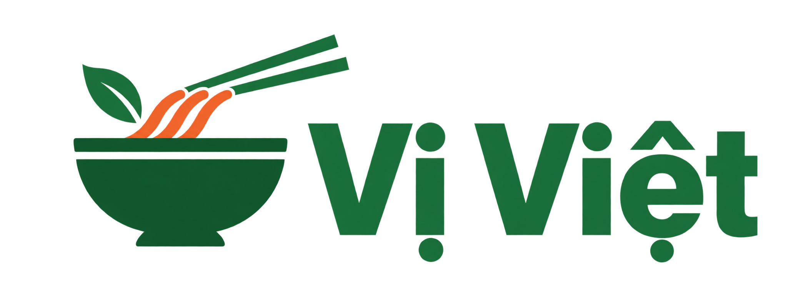
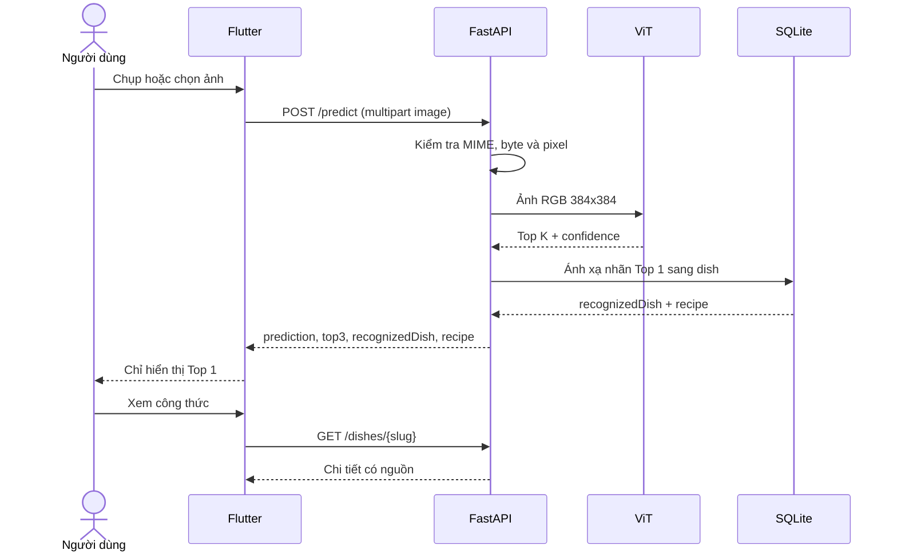
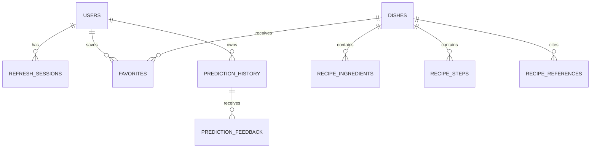
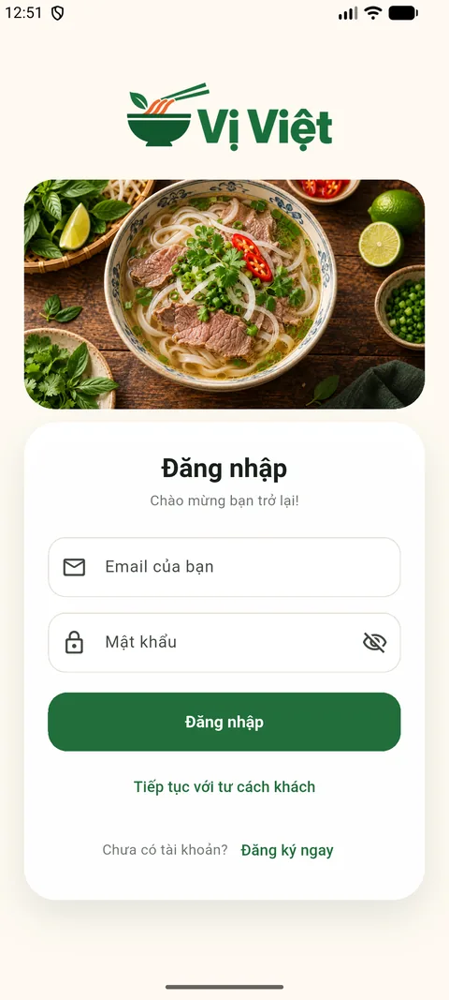
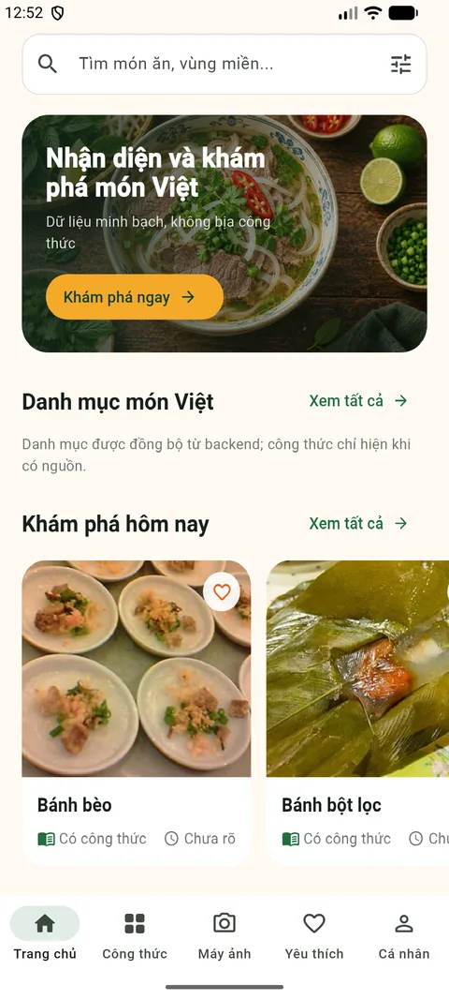
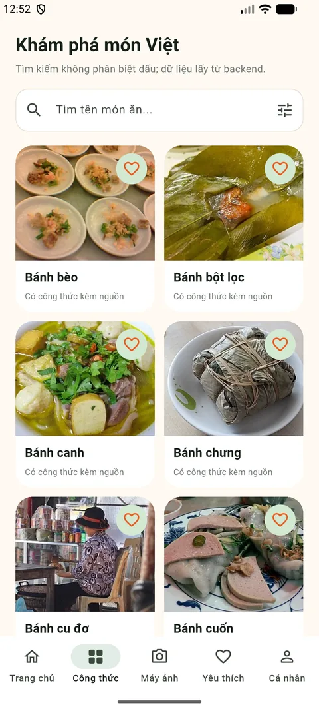
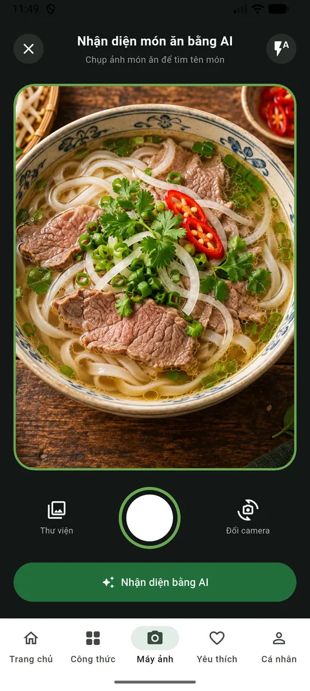
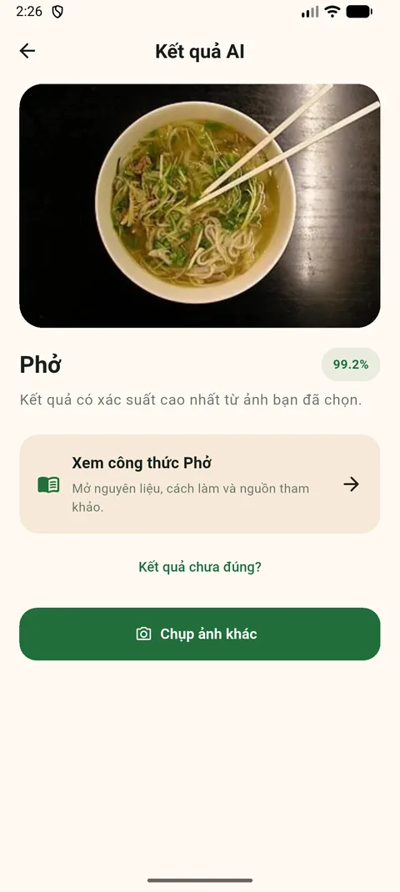
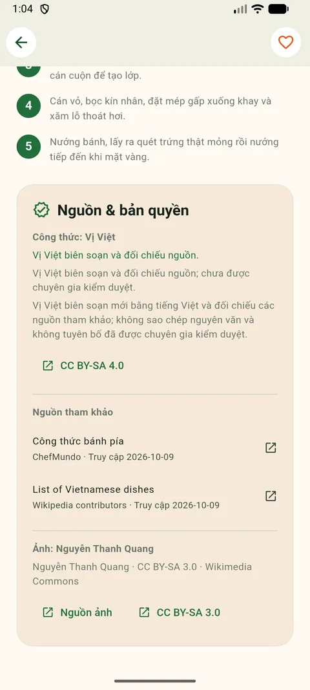

<p align="center">
  
</p>

<h1 align="center">Vị Việt</h1>

<p align="center">
  <strong>Hệ thống gợi ý, tìm kiếm công thức và nhận diện món ăn Việt bằng AI</strong>
</p>

<p align="center">
  Ứng dụng Flutter kết hợp FastAPI, SQLite và Vision Transformer để giúp người
  dùng khám phá ẩm thực Việt từ tên món hoặc hình ảnh, với công thức và ảnh có
  nguồn minh bạch.
</p>

<p align="center">
  
  
  
  
  
  
</p>

<p align="center">
  
  
  
</p>

> Trạng thái xác nhận ngày **25/10/2026**: database local có 38 món đã xuất
> bản, 38 ảnh có metadata giấy phép, 348 nguyên liệu, 205 bước nấu và 85 nguồn
> tham khảo. Backend test, Flutter test, audit dữ liệu và APK debug đều đạt.

## Mục lục

- [1. Giới thiệu](#1-giới-thiệu)
- [2. Mục tiêu và đối tượng sử dụng](#2-mục-tiêu-và-đối-tượng-sử-dụng)
- [3. Chức năng](#3-chức-năng)
- [4. Công nghệ sử dụng](#4-công-nghệ-sử-dụng)
- [5. Kiến trúc hệ thống](#5-kiến-trúc-hệ-thống)
- [6. Luồng nhận diện AI](#6-luồng-nhận-diện-ai)
- [7. Cấu trúc thư mục](#7-cấu-trúc-thư-mục)
- [8. Yêu cầu hệ thống](#8-yêu-cầu-hệ-thống)
- [9. Cài đặt từ máy mới](#9-cài-đặt-từ-máy-mới)
- [10. Chạy dự án](#10-chạy-dự-án)
- [11. Cấu hình môi trường và lưu trữ](#11-cấu-hình-môi-trường-và-lưu-trữ)
- [12. Hướng dẫn sử dụng](#12-hướng-dẫn-sử-dụng)
- [13. API](#13-api)
- [14. Database, migration và importer](#14-database-migration-và-importer)
- [15. Model AI và dataset](#15-model-ai-và-dataset)
- [16. Công thức, ảnh và giấy phép dữ liệu](#16-công-thức-ảnh-và-giấy-phép-dữ-liệu)
- [17. Kiểm thử và build](#17-kiểm-thử-và-build)
- [18. Demo giao diện](#18-demo-giao-diện)
- [19. Bảo mật, quyền riêng tư và xử lý lỗi](#19-bảo-mật-quyền-riêng-tư-và-xử-lý-lỗi)
- [20. Đóng góp, giấy phép và tài liệu](#20-đóng-góp-giấy-phép-và-tài-liệu)

## 1. Giới thiệu

Ẩm thực Việt có nhiều món gần giống nhau về hình thức, tên gọi vùng miền và
cách chế biến. Người dùng thường phải tìm kiếm ở nhiều nguồn, trong khi ảnh và
công thức trên Internet không phải lúc nào cũng có xuất xứ hoặc giấy phép rõ
ràng.

Vị Việt giải quyết bài toán này bằng một trải nghiệm thống nhất:

- tìm món theo tên có dấu hoặc không dấu;
- khám phá danh mục món Việt kèm ảnh thật;
- nhận diện món ăn từ camera hoặc thư viện bằng AI;
- mở trực tiếp công thức của kết quả Top 1;
- hiển thị nguồn công thức, nguồn ảnh và giấy phép ngay trong ứng dụng;
- lưu yêu thích, lịch sử và feedback khi người dùng đăng nhập.

Project không tạo công thức giả. Một món chỉ được hiển thị là “Có công thức”
khi backend xác nhận đủ nội dung, nguồn, giấy phép và metadata ảnh.

## 2. Mục tiêu và đối tượng sử dụng

### Mục tiêu

1. Xây dựng ứng dụng mobile dễ dùng để khám phá ẩm thực Việt.
2. Kết hợp nhận diện ảnh với catalog công thức có thể kiểm chứng.
3. Bảo đảm dữ liệu công thức và ảnh có nguồn, attribution và giấy phép rõ ràng.
4. Hỗ trợ tài khoản, yêu thích, lịch sử và feedback mà không lưu ảnh upload.
5. Tạo nền tảng đánh giá model và phát triển candidate model có kiểm soát.

### Đối tượng sử dụng

- người muốn tìm hiểu và tự nấu món Việt;
- người cần nhận diện nhanh một món ăn từ ảnh;
- giảng viên/người đánh giá muốn kiểm tra một hệ thống Flutter–AI hoàn chỉnh;
- lập trình viên muốn tham khảo cách tích hợp Flutter, FastAPI và ViT.

### Phạm vi hiện tại

- ứng dụng chạy local trên Android Emulator, Android, web và desktop Flutter;
- backend FastAPI và SQLite chạy trên máy host;
- model production có 38 nhãn;
- chưa có public deployment, CI/CD, Docker hoặc trang quản trị;
- feedback chỉ được lưu để đánh giá, chưa tự động huấn luyện model.

## 3. Chức năng

### Đã hoàn thành

- [x] Đăng ký, đăng nhập, refresh token, đăng xuất và cập nhật hồ sơ.
- [x] Dùng ứng dụng với tư cách khách.
- [x] Danh mục 38 món lấy từ backend, có tìm kiếm và bộ lọc.
- [x] Tìm kiếm tên món có dấu hoặc không dấu.
- [x] Chi tiết công thức gồm mô tả, nguyên liệu, bước làm và nguồn.
- [x] 38/38 món có thời gian sơ chế, nấu, tổng thời gian và khẩu phần có nguồn.
- [x] 38/38 ảnh món được phục vụ local, không hotlink.
- [x] Chụp hoặc chọn ảnh và gửi multipart tới backend.
- [x] Kết quả AI tối giản, chỉ hiển thị Top 1 và confidence thực tế.
- [x] Mở đúng công thức từ `recognizedDish` của kết quả AI.
- [x] Gửi feedback “Kết quả chưa đúng?” từ danh mục 38 món.
- [x] Yêu thích và lịch sử riêng theo tài khoản.
- [x] Giao diện mobile và responsive desktop/web.
- [x] Attribution công thức, nguồn tham khảo và giấy phép ảnh.

### Roadmap

- [ ] Đánh giá toàn bộ tập Test sạch và công bố confusion matrix.
- [ ] Bổ sung dataset hợp lệ cho 8 nhãn chưa có trong 30VNFoods.
- [ ] Fine-tune candidate model có version, model card và rollback.
- [ ] Tối ưu model cho thiết bị yếu bằng quantization hoặc distillation.
- [ ] Xây dựng trang quản trị và quy trình duyệt nội dung.
- [ ] Chuyển sang PostgreSQL và rate limit dùng chung khi triển khai nhiều máy.
- [ ] Bổ sung CI, release signing và kiểm thử trên thiết bị Android thật.

## 4. Công nghệ sử dụng

Các phiên bản “đã kiểm chứng” là môi trường dùng để nghiệm thu project. Khoảng
phiên bản được quản lý bởi `backend/requirements.txt` và `mobile/pubspec.yaml`.

| Thành phần | Công nghệ | Phiên bản đã kiểm chứng | Vai trò |
| --- | --- | ---: | --- |
| Mobile/Web UI | Flutter | 3.47.2 | Giao diện đa nền tảng |
| Ngôn ngữ mobile | Dart | 3.13.2 | UI, state và API client |
| Backend | FastAPI | 0.141.1 | REST API và validation |
| ASGI server | Uvicorn | 0.54.0 | Chạy backend local |
| Ngôn ngữ backend | Python | 3.13.7 | API, import và ML pipeline |
| AI runtime | PyTorch | 2.14.0 | Suy luận model |
| Model library | Transformers | 5.17.0 | ViT processor/model loader |
| ORM | SQLAlchemy | 2.1.3 | Truy cập dữ liệu |
| Migration | Alembic | 1.20.0 | Version hóa schema |
| Database | SQLite | tích hợp Python | Dữ liệu local |
| Authentication | JWT + Argon2 | PyJWT 2.15.1 | Phiên và mật khẩu |
| HTTP client | `http` | 1.6.0 | Flutter gọi REST/multipart |
| Secure storage | `flutter_secure_storage` | 9.2.4 | Lưu token trên client |

## 5. Kiến trúc hệ thống

```mermaid
flowchart TB
    U[Người dùng] --> F[Flutter App]
    F --> S[AppState]
    S --> C[ApiClient / AiService]
    C -->|JSON + multipart| A[FastAPI]

    A --> AU[Auth / User]
    A --> DI[Dish / Favorite]
    A --> HI[History / Feedback]
    A --> PR[Predict]
    A --> ME[/media/dishes]

    AU --> DB[(SQLite)]
    DI --> DB
    HI --> DB
    PR --> V[ViT-L/16 - 38 nhãn]
    V --> MAP[Chuẩn hóa và ánh xạ món]
    MAP --> DB
    DB --> R[Công thức + nguồn + giấy phép]
    R --> A
```

### Nguyên tắc kiến trúc

- Flutter không dùng danh sách công thức giả làm nguồn dữ liệu chính.
- FastAPI quyết định món nào đủ điều kiện xuất bản.
- model được nạp theo singleton để tránh tạo lại trên mỗi request.
- database chỉ lưu đường dẫn ảnh tương đối `/media/dishes/...`.
- raw dataset, model, database và cache không nằm trong Git.
- catalog công thức và manifest giấy phép được theo dõi cùng source code.

Xem chi tiết tại [`docs/architecture.md`](docs/architecture.md).

## 6. Luồng nhận diện AI



Backend vẫn giữ `top3` để phục vụ lịch sử và đánh giá, nhưng giao diện chính
chỉ hiển thị một kết quả. Nếu nhãn model không ánh xạ được sang catalog, app
không tự chọn món gần giống và vô hiệu hóa thẻ công thức.

## 7. Cấu trúc thư mục

```text
appfood4/
├── backend/
│   ├── ai/                    # Nạp model và suy luận
│   ├── data/recipes/          # Catalog và manifest giấy phép
│   ├── migrations/            # Alembic migrations
│   ├── models/                # Model local, không commit
│   ├── recipes/               # Chuẩn hóa và repository
│   ├── routers/               # Auth, user, dish, activity
│   ├── scripts/               # Download, import, audit, evaluate
│   ├── static/dishes/         # 38 ảnh món được theo dõi trong Git
│   └── tests/                 # Unit và API tests
├── mobile/
│   ├── assets/                # Logo, ảnh giao diện và font
│   ├── lib/                   # Source Flutter
│   ├── test/                  # Widget, state và golden tests
│   └── android/ ios/ web/     # Platform projects
├── datasets/
│   ├── raw/                   # Dataset gốc, không commit
│   ├── processed/             # Split sạch, không commit
│   └── 30VNFoods-main/        # Mã upstream tham khảo
├── artifacts/                 # Backup, audit, log, evaluation, build evidence
├── docs/                      # Tài liệu và ảnh demo
├── scripts/                   # Tiện ích cấp workspace
├── .run/                      # Run configuration Android Studio
├── alembic.ini
├── setup_backend.bat
└── run_backend.bat
```

Các đường dẫn runtime quan trọng được giữ cố định để không phải tải lại model,
không mất database và không phá importer.

## 8. Yêu cầu hệ thống

### Bắt buộc

- Windows 10/11 64-bit;
- Git;
- Python tương thích dependency PyTorch;
- Flutter SDK và Dart;
- Android Studio có Flutter/Dart plugin;
- Android SDK, platform tools và JDK 17;
- Android Emulator hoặc thiết bị Android.

### Khuyến nghị

- RAM tối thiểu 8 GB, khuyến nghị 16 GB khi chạy emulator cùng model;
- ít nhất 20 GB trống trên ổ D nếu tải cả dataset và cache;
- mạng ổn định cho lần tải model/dependency đầu tiên;
- GPU là tùy chọn; model vẫn chạy CPU nhưng chậm hơn.

Kiểm tra công cụ:

```bat
git --version
python --version
flutter --version
flutter doctor -v
```

## 9. Cài đặt từ máy mới

### Bước 1 — Clone repository

```bat
git clone https://github.com/nguyenhuuphucasd1/appfood4.git
cd appfood4
```

### Bước 2 — Cài backend

```bat
setup_backend.bat
```

Script thực hiện:

1. tạo `.venv` tại root;
2. trỏ pip/Hugging Face/Torch/temp cache vào ổ D;
3. cài `backend/requirements.txt`;
4. chạy migration;
5. tải model vào `backend/models/vietnamese_food_classifier/`.

Cài thủ công khi cần:

```bat
python -m venv .venv
.venv\Scripts\python -m pip install -r backend\requirements.txt
.venv\Scripts\python -m backend.migrations.runner
.venv\Scripts\python backend\scripts\download_model.py
```

### Bước 3 — Cài Flutter dependency

```bat
cd mobile
flutter pub get
flutter doctor -v
cd ..
```

### Bước 4 — Chuẩn bị dữ liệu công thức

Catalog và ảnh món nằm trong Git, nhưng database local không được commit. Chạy
migration và importer theo phần [Database, migration và importer](#14-database-migration-và-importer).

## 10. Chạy dự án

### Chạy backend

Từ root project:

```bat
run_backend.bat
```

Giữ terminal này mở. Kiểm tra:

- Health: <http://127.0.0.1:8000/health>
- Swagger: <http://127.0.0.1:8000/docs>

### Chạy Flutter bằng terminal

```bat
cd mobile
flutter run
```

URL mặc định:

| Nền tảng | Backend URL |
| --- | --- |
| Android Emulator | `http://10.0.2.2:8000` |
| Flutter Web/Windows/iOS simulator | `http://127.0.0.1:8000` |
| Thiết bị thật | IP LAN của máy chạy backend |

Thiết bị thật:

```bat
flutter run --dart-define=API_BASE_URL=http://192.168.1.10:8000
```

Web:

```bat
flutter run -d chrome --web-port=8080 --dart-define=API_BASE_URL=http://127.0.0.1:8000
```

### Chạy bằng Android Studio và Shift+F10

1. Mở đúng thư mục root `D:\appfood4`.
2. Chạy `run_backend.bat` trong terminal riêng.
3. Mở Device Manager và khởi động Android Emulator.
4. Chọn configuration **Vị Việt - Flutter**.
5. Chọn emulator trong device selector.
6. Nhấn `Shift+F10` hoặc nút Run.

Configuration dùng chung tại `.run/Vi_Viet_Flutter.run.xml` trỏ tới
`mobile/lib/main.dart`. Backend không được gắn vào Gradle.

## 11. Cấu hình môi trường và lưu trữ

Backend đọc biến môi trường của process, không tự nạp file `.env`.

| Biến | Mặc định | Vai trò |
| --- | --- | --- |
| `DATABASE_URL` | SQLite `backend/data/vi_viet.db` | Kết nối database |
| `APP_ENV` | `development` | Bật kiểm tra production |
| `AUTH_SECRET_KEY` | ngẫu nhiên mỗi process dev | Khóa JWT |
| `ACCESS_TOKEN_MINUTES` | `30` | Thời hạn access token |
| `REFRESH_TOKEN_DAYS` | `30` | Thời hạn refresh token |
| `CORS_ORIGINS` | localhost/127.0.0.1 cổng 3000, 8080 | Origin web |
| `MODEL_LOAD_ON_STARTUP` | `true` | Nạp model khi start |
| `CONFIDENCE_THRESHOLD` | `0.60` | Ngưỡng `accepted` |
| `TOP_K` | `3` | Số dự đoán backend giữ |
| `MAX_IMAGE_BYTES` | `10485760` | Giới hạn upload 10 MB |
| `MAX_IMAGE_PIXELS` | `40000000` | Giới hạn tổng pixel |
| `AUTH_RATE_LIMIT_PER_MINUTE` | `60` | Rate limit auth/IP |
| `PREDICT_RATE_LIMIT_PER_MINUTE` | `30` | Rate limit predict/IP |

Ví dụ PowerShell:

```powershell
$env:AUTH_SECRET_KEY = "chuoi-ngau-nhien-toi-thieu-32-byte"
$env:CORS_ORIGINS = "http://localhost:8080,http://127.0.0.1:8080"
$env:MODEL_LOAD_ON_STARTUP = "true"
```

Trong production, `AUTH_SECRET_KEY` bắt buộc dài ít nhất 32 byte.

### Chính sách ổ D

Model, dataset, cache và artifact phải nằm trong `D:\appfood4`:

| Dữ liệu | Thư mục |
| --- | --- |
| Hugging Face, Torch, pip, temp | `.cache/` |
| Kaggle token/config | `.kaggle/` |
| Python environment | `.venv/` |
| Dataset | `datasets/raw/`, `datasets/processed/` |
| Model | `backend/models/` |
| Backup, log, evaluation | `artifacts/` |
| Flutter/Gradle build | `mobile/build/` |

Các thư mục trên bị loại khỏi Git. Không gửi hoặc commit token Kaggle, `.env`,
database, model, dataset, checkpoint hoặc ảnh upload.

## 12. Hướng dẫn sử dụng

### Chế độ khách

1. Chọn **Tiếp tục với tư cách khách**.
2. Duyệt trang chủ hoặc mở tab **Công thức**.
3. Tìm món theo tên và dùng bộ lọc khi cần.
4. Chọn một món để xem nguyên liệu, bước làm và nguồn.
5. Mở tab **Máy ảnh**, chụp hoặc chọn ảnh món.
6. Nhấn **Nhận diện bằng AI**.
7. Xem Top 1 và nhấn **Xem công thức** để mở đúng món.

### Tài khoản đăng nhập

Ngoài chức năng khách, tài khoản có thể:

- lưu và bỏ món yêu thích;
- xem/xóa lịch sử nhận diện;
- gửi feedback khi dự đoán chưa đúng;
- cập nhật họ tên;
- tự khôi phục phiên bằng refresh token.

Ảnh nhận diện chỉ được giữ trong bộ nhớ để preview; backend không lưu ảnh và
ghi `imageStored=false` trong lịch sử.

## 13. API

Endpoint cá nhân nhận `Authorization: Bearer <accessToken>`.

| Method | Endpoint | Xác thực | Chức năng |
| --- | --- | --- | --- |
| `GET` | `/health` | Không | Health check |
| `POST` | `/auth/register` | Không | Đăng ký |
| `POST` | `/auth/login` | Không | Đăng nhập |
| `POST` | `/auth/refresh` | Refresh token | Xoay vòng token |
| `POST` | `/auth/logout` | Refresh token | Thu hồi phiên |
| `GET/PATCH` | `/users/me` | Bắt buộc | Đọc/cập nhật hồ sơ |
| `GET` | `/dishes` | Tùy chọn | Tìm, lọc và phân trang |
| `GET` | `/dishes/{slug}` | Tùy chọn | Chi tiết công thức |
| `GET/POST` | `/favorites` | Bắt buộc | Đọc/thêm yêu thích |
| `DELETE` | `/favorites/{slug}` | Bắt buộc | Bỏ yêu thích |
| `GET/DELETE` | `/history` | Bắt buộc | Đọc/xóa lịch sử |
| `DELETE` | `/history/{id}` | Bắt buộc | Xóa một mục |
| `POST` | `/predictions/{id}/feedback` | Bắt buộc | Gửi nhãn đúng |
| `POST` | `/predict` | Tùy chọn | Nhận diện ảnh |

Ví dụ nhận diện:

```bash
curl -F "image=@food.jpg" http://127.0.0.1:8000/predict
```

`POST /predict` nhận JPEG/JPG/PNG tối đa 10 MB. Response gồm `prediction`,
`top3`, `canonicalDish`, `recognizedDish`, `recipe` và `recipeMessage`.

Contract đầy đủ: [`docs/api.md`](docs/api.md) hoặc Swagger `/docs`.

## 14. Database, migration và importer

Database mặc định: `backend/data/vi_viet.db`.



### Migration

- `20261005_0001`: schema MVP;
- `20261009_0002`: metadata công thức, ảnh và giấy phép;
- `20261009_0003`: nguồn gốc nội dung, xác minh và references.

```bat
.venv\Scripts\python -m backend.migrations.runner
```

### Import công thức

Importer chạy theo transaction, cập nhật theo `slug` và không đổi ID món.

```bat
.venv\Scripts\python -m backend.scripts.import_recipes backend\data\recipes\open_recipes.vi.json backend\data\recipes\verified_recipes.vi.json --media-manifest backend\data\recipes\media_manifest.json --dry-run
.venv\Scripts\python -m backend.scripts.import_recipes backend\data\recipes\open_recipes.vi.json backend\data\recipes\verified_recipes.vi.json --media-manifest backend\data\recipes\media_manifest.json
.venv\Scripts\python -m backend.scripts.audit_recipe_data
```

Import thật tự sao lưu SQLite vào `artifacts/backups/`. Một bản ghi sai khiến
toàn bộ giao dịch rollback thay vì để database ở trạng thái nhập dở.

## 15. Model AI và dataset

### Model production

- Model: [`VietTung04/vit-l-16-food-classifier`](https://huggingface.co/VietTung04/vit-l-16-food-classifier)
- Kiến trúc: `ViTForImageClassification` (ViT-L/16)
- Input: RGB 384×384
- Số nhãn: 38
- Trọng số: khoảng 1,21 GB
- Local path: `backend/models/vietnamese_food_classifier/`

`AutoImageProcessor` đọc cấu hình chính thức của model. Suy luận dùng
`torch.inference_mode()` và model singleton.

### Dataset 30VNFoods

- Nguồn Kaggle: `quandang/vietnamese-foods`;
- raw path: `datasets/raw/30VNFoods/`;
- 25.136 ảnh, 30 lớp;
- 30/30 lớp khớp với 30 trong 38 nhãn model;
- split sạch còn 25.032 ảnh sau khi loại trùng/mâu thuẫn;
- dataset chỉ dùng để audit, đánh giá và candidate fine-tune;
- ảnh dataset không được dùng tự động làm ảnh minh họa công thức.

Tám nhãn model chưa có trong dataset: Bánh cu đơ, Nem nướng, Bánh mì cay, Cơm
cháy, Bò bía, Bánh đậu xanh, Bánh đa cua và Bún cá.

Đánh giá mẫu hiện có đúng 28/30 ảnh. Đây là mẫu nhỏ, không phải accuracy toàn
bộ Test và không được dùng để tuyên bố hiệu năng tổng thể.

Chi tiết: [`docs/ml-and-dataset.md`](docs/ml-and-dataset.md).

## 16. Công thức, ảnh và giấy phép dữ liệu

### Công thức

- 8 món được dịch và chuẩn hóa từ phiên bản cố định của Wikibooks;
- 30 món do Vị Việt biên soạn mới và đối chiếu tối thiểu hai nguồn;
- nội dung công thức dùng CC BY-SA 4.0 với attribution và ghi chú chỉnh sửa;
- 38/38 món có thời gian sơ chế, nấu, tổng thời gian và khẩu phần từ nguồn
  nằm trong danh sách tham khảo; độ khó vẫn có thể để trống nếu nguồn không nêu.

### Ảnh

- ảnh đến từ Wikimedia Commons/Openverse;
- chỉ chấp nhận Public Domain, CC0, CC BY hoặc CC BY-SA;
- không dùng ảnh NC, ND, fair-use, thiếu tác giả hoặc ảnh train;
- ảnh được lưu WebP tại `backend/static/dishes/`, không hotlink;
- metadata nguồn, tác giả, giấy phép và SHA-256 nằm trong
  `backend/data/recipes/media_manifest.json`.

### Điều kiện `hasRecipe=true`

Món phải có nguồn, URL phiên bản, giấy phép, attribution, trạng thái xác minh,
thời gian sơ chế/nấu/tổng, khẩu phần dạng văn bản, ít nhất một nguyên liệu, một
bước nấu và metadata ảnh hợp lệ. Nguồn của thời gian/khẩu phần phải có trong
danh sách tham khảo; nội dung biên soạn cần tối thiểu hai reference.

Chi tiết: [`docs/data-and-licensing.md`](docs/data-and-licensing.md).

## 17. Kiểm thử và build

### Kết quả gần nhất

| Hạng mục | Kết quả |
| --- | ---: |
| Backend unit/API tests | 24/24 đạt |
| Flutter tests | 21/21 đạt |
| `flutter analyze` | Không có lỗi |
| Audit công thức | 38 món, 38 ảnh, 0 lỗi |
| API `/health`, `/dishes`, `/predict` | Đạt |
| Media path traversal | Bị chặn với 404 |
| Android Emulator | Build, cài và chạy thành công |
| APK debug | Build thành công |

### Backend

```bat
.venv\Scripts\python -m unittest discover -s backend\tests -p "test_*.py" -v
.venv\Scripts\python -m backend.scripts.audit_recipe_data
```

### Flutter

```bat
cd mobile
flutter analyze
flutter test
flutter build apk --debug
```

APK debug:

```text
mobile/build/app/outputs/flutter-apk/app-debug.apk
```

### Luồng nghiệm thu

1. Danh mục → chọn món → xem nguyên liệu, bước nấu và nguồn.
2. Máy ảnh → chọn ảnh Phở → Top 1 Phở → mở đúng công thức.
3. Đăng nhập → yêu thích → lịch sử → feedback.

## 18. Demo giao diện

<table>
  <tr>
    <td align="center"><strong>Đăng nhập</strong></td>
    <td align="center"><strong>Trang chủ</strong></td>
    <td align="center"><strong>Danh mục</strong></td>
  </tr>
  <tr>
    <td></td>
    <td></td>
    <td></td>
  </tr>
  <tr>
    <td align="center"><strong>Camera AI</strong></td>
    <td align="center"><strong>Kết quả Top 1</strong></td>
    <td align="center"><strong>Nguồn & bản quyền</strong></td>
  </tr>
  <tr>
    <td></td>
    <td></td>
    <td></td>
  </tr>
</table>

Ảnh demo không chứa email, token, mật khẩu hoặc dữ liệu tài khoản thật.

## 19. Bảo mật, quyền riêng tư và xử lý lỗi

### Bảo mật và quyền riêng tư

- mật khẩu được băm Argon2 qua `pwdlib`;
- access token và refresh token dùng JWT HS256;
- refresh session được xoay vòng và thu hồi khi logout;
- Flutter lưu token bằng `flutter_secure_storage`;
- ảnh nhận diện không được lưu trên backend;
- backend giới hạn MIME, byte, pixel và tần suất request;
- production từ chối start khi `AUTH_SECRET_KEY` thiếu hoặc ngắn;
- database, secret, model, dataset và artifact bị loại khỏi Git.

Rate limiter hiện nằm trong bộ nhớ của từng process. Triển khai production cần
HTTPS, reverse proxy, secret manager, PostgreSQL và rate limiter dùng chung.

### Lỗi thường gặp

#### Android Emulator không gọi được backend

- chạy `run_backend.bat` trước;
- kiểm tra <http://127.0.0.1:8000/health> trên máy host;
- Android Emulator phải dùng `http://10.0.2.2:8000`;
- kiểm tra firewall cổng 8000.

#### Shift+F10 không có configuration

- mở root `D:\appfood4`, không mở riêng `mobile`;
- bật Flutter và Dart plugin;
- chạy `flutter pub get` trong `mobile`;
- chọn **Vị Việt - Flutter** và một emulator đang online.

#### Backend trả 503

```bat
.venv\Scripts\python backend\scripts\download_model.py
```

Kiểm tra model local và dung lượng ổ D.

#### Web bị CORS

Chạy web ở cổng 8080 hoặc thêm origin chính xác vào `CORS_ORIGINS`, sau đó
khởi động lại backend.

#### Công thức hoặc ảnh không hiển thị

- kiểm tra `/dishes/{slug}` và `hasRecipe`;
- chạy `backend.scripts.audit_recipe_data`;
- xác nhận ảnh tồn tại trong `backend/static/dishes/`;
- database chỉ nên lưu `/media/dishes/...`, không hard-code `localhost`.

Hướng dẫn chi tiết: [`docs/setup-and-run.md`](docs/setup-and-run.md).

## 20. Đóng góp, giấy phép và tài liệu

### Chính sách đóng góp

Project hiện không nhận đóng góp công khai. Người đã được chủ dự án cho phép
có thể làm việc theo quy trình:

1. tạo branch theo phạm vi thay đổi;
2. không commit token, database, model, dataset hoặc artifact;
3. chạy backend test, audit, `flutter analyze` và Flutter test;
4. mô tả dữ liệu/giấy phép nếu bổ sung công thức hoặc ảnh;
5. tạo Pull Request để review trước khi hợp nhất.

Việc gửi mã nguồn không tự động cấp quyền sử dụng lại project.

### Giấy phép

Mã nguồn Vị Việt **không được phát hành theo giấy phép nguồn mở**. Mọi quyền
được bảo lưu; source được cung cấp để xem xét đồ án/portfolio và chỉ được chạy
cho mục đích đánh giá theo nội dung trong [`LICENSE`](LICENSE).

Giấy phép mã nguồn không thay đổi quyền của nội dung bên thứ ba:

- công thức và bản chuyển thể: CC BY-SA 4.0 theo metadata;
- ảnh: giấy phép riêng của từng file;
- model Hugging Face: theo model card của tác giả;
- 30VNFoods: theo `LICENSE` đi kèm gói dataset;
- Flutter/Python dependencies: theo giấy phép của từng package.

### Tài liệu kỹ thuật

- [Kiến trúc hệ thống](docs/architecture.md)
- [API](docs/api.md)
- [Dữ liệu và giấy phép](docs/data-and-licensing.md)
- [Model và dataset](docs/ml-and-dataset.md)
- [Cài đặt và chạy](docs/setup-and-run.md)
- [Báo cáo audit ban đầu — tài liệu lịch sử](docs/history/initial-audit.md)
- [Hướng dẫn Flutter](mobile/README.md)

---

<p align="center">
  <strong>Vị Việt — khám phá món Việt bằng dữ liệu minh bạch và AI.</strong>
</p>
